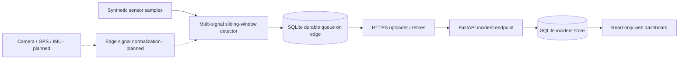

# RDAS — Real-time Driving Assistance System (Starter Prototype)

An **early-stage, locally runnable proof of concept** for offline-first road-incident event collection in Rwanda. This code demonstrates a synthetic edge detection loop, a durable SQLite event queue, retryable uploads, a REST API, and a read-only monitoring dashboard.

> **Safety / scope:** This is research/demo software only, not a validated collision detection system, and **must not be used to automatically dispatch emergency services**. It does not yet process actual camera footage, read a GPS receiver, use an IMU, route ambulances, or interface with emergency providers. The sample latitude/longitude are illustrative.

## Architecture



### False-positive strategy

The `CandidateDetector` uses an illustrative weighted score: 50% vision confidence, 30% impact and 20% speed change. Only a sustained set of high-confidence readings within a rolling ten-sample buffer emits a candidate, suppressing isolated bumps in a simple simulation. **Weights and thresholds are not clinically or field validated.** Real-world use would require labeled datasets, GPS/IMU sampling calibration, robust vision inference and extensive testing for false positives and false negatives.

### Connectivity strategy

When offline, the edge client stores candidate events in SQLite. Sync attempts send stable event IDs; the API is idempotent by ID so retries do not double count. Events remain queued until the server acknowledges. The `--watch` mode uses a basic capped backoff. No cellular modem integration is included; supply connectivity separately. If a device stays offline, **real-time remote alerts are impossible**.

## Quickstart (Python 3.10+)

From the repository root:

```bash
python3 -m venv .venv
source .venv/bin/activate  # Windows: .venv\Scripts\activate
pip install -r requirements.txt
uvicorn backend.app:app --reload
```

Open **http://127.0.0.1:8000** for the dashboard. In another terminal (with the environment activated):

```bash
python -m edge.client --simulate --sync
```

Refresh the dashboard. It should show **one unverified synthetic incident candidate**, while the preceding pothole-like sequence produces none.

Try offline-first behavior: stop the server; run `python -m edge.client --simulate --sync` and see the event remain queued; restart the server and run `python -m edge.client --sync` to transmit it. Run `python -m edge.client --watch` to retry automatically.

Test the components:

```bash
pytest -q
```

## Suggested development milestones

1. Add actual Raspberry Pi camera / IMU / GPS adapters with timestamped sensor data.
2. Benchmark real detection models and tune thresholds using consented, labeled events; test potholes, harsh braking, shadows, weather and night driving.
3. Add device authentication, encryption, secure provisioning and data minimization.
4. Add incident review, manual verification, audit logs and operational monitoring.
5. Only after agreements with emergency providers and extensive field validation, consider any real dispatch integration.

## What this repo proves

- Runnable API and monitoring page
- Durable edge-side storage across connection failures
- Duplicate-safe upload handling
- Tested, **illustrative** temporal filtering logic

It **does not prove** real-world accident accuracy, end-to-end vehicle integration, partner acceptance or production readiness.

## Authorship

Starter implementation created with AI assistance. Adapt, test and document your own hardware work before claiming it as completed or field-tested.
# RDAS
